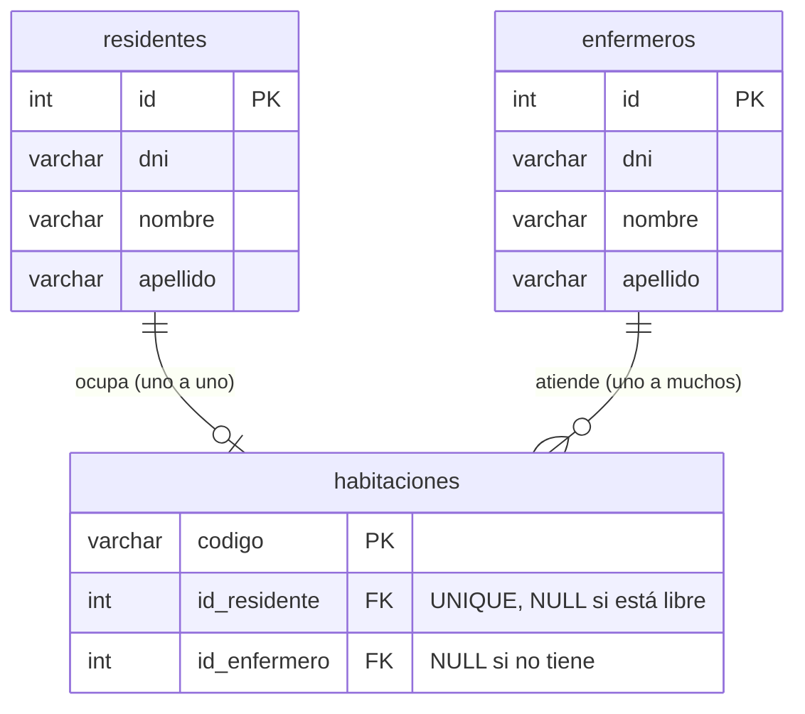
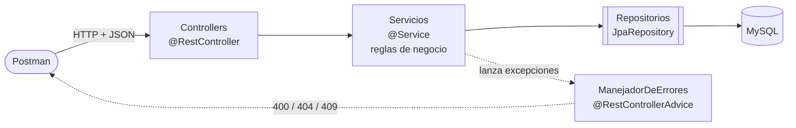

# Gestión de Residencia Geriátrica - API REST con Spring Boot

API REST para administrar una residencia geriátrica: residentes, enfermeros, habitaciones, quién ocupa cada habitación y qué enfermero la atiende.

Proyecto de **Programación II** (INSPT-UTN). Es la misma aplicación que la [versión de consola](https://github.com/Emanuelbig/gestion-residencia-geriatrica-java-mvc) (MVC en capas con archivos), pasada a **Spring Boot + JPA + MySQL**. Las reglas de negocio son las mismas; lo que cambia es cómo se guardan los datos y cómo se usa el sistema: en lugar de menús de consola, se usa por HTTP (con Postman, o desde el [frontend web](https://github.com/Emanuelbig/gestion-residencia-geriatrica-frontend-jsp) hecho con Servlets y JSP).

La consigna original del parcial, y qué endpoint y qué clase cumplen cada punto, está en [docs/CONSIGNA.md](docs/CONSIGNA.md).

---

## Tecnologías

| | |
|---|---|
| Lenguaje | Java 21 |
| Framework | Spring Boot 4.1 (Spring Web MVC, Spring Data JPA, Validation) |
| Persistencia | Hibernate (JPA) sobre MySQL |
| Build | Maven |
| Pruebas de la API | Postman |

---

## Cómo ejecutarlo

1. **Crear la base con datos de prueba:** abrir [`base-de-datos.sql`](base-de-datos.sql) en MySQL Workbench y ejecutarlo (el rayo). Crea la base `geriatrico`, las 3 tablas y carga 4 residentes, 3 enfermeros y 5 habitaciones (3 ocupadas y con enfermero).
   Si preferís empezar vacío, alcanza con `CREATE DATABASE geriatrico;`: Hibernate crea las tablas solo al arrancar.
2. Crear el archivo `src/main/resources/secreto.properties` (al lado de `application.properties`) con tu usuario y contraseña de MySQL:
   ```properties
   spring.datasource.username=root
   spring.datasource.password=TU_CLAVE
   ```
   `application.properties` lo importa y sus valores reemplazan a los de ejemplo (`youruser` / `yourpassword`). Este archivo está en `.gitignore`, así la contraseña nunca se sube al repositorio.
   Con `ddl-auto=update`, Hibernate crea las tablas que falten a partir de las entidades.
3. Ejecutar con **F6** en NetBeans, o desde la terminal:
   ```bash
   mvnw spring-boot:run
   ```
4. Cuando la consola muestra `Tomcat started on port 8081`, la API está escuchando en `http://localhost:8081` (el puerto se define con `server.port` en `application.properties`; el 8080 queda libre para el [frontend](https://github.com/Emanuelbig/gestion-residencia-geriatrica-frontend-jsp)).

> `http://localhost:8081` solo (sin ruta) da un error 404: es normal, porque la API no tiene página de inicio. Hay que llamar a un endpoint, por ejemplo `http://localhost:8081/residentes`.

---

## Endpoints

### Residentes (`/residentes`) y enfermeros (`/enfermeros`)

Los dos tienen los mismos endpoints (comparten la clase `PersonaController`).

| Método | Ruta | Body | Respuesta |
|---|---|---|---|
| GET | `/residentes` | — | 200 + lista |
| GET | `/residentes/{id}` | — | 200 + residente · 404 si no existe |
| POST | `/residentes` | `{"dni": "30111222", "nombre": "juan", "apellido": "perez"}` | **201** + residente creado con su id |
| PUT | `/residentes/{id}` | igual que el POST | 200 + residente modificado |
| DELETE | `/residentes/{id}` | — | **204** · 409 si tiene habitación |

### Habitaciones (`/habitaciones`)

| Método | Ruta | Respuesta |
|---|---|---|
| GET | `/habitaciones` | 200 + lista con código y si está ocupada |
| GET | `/habitaciones/{codigo}` | 200 + detalle: quién la ocupa y qué enfermero la atiende |
| POST | `/habitaciones` (sin body) | **201** + la habitación creada (el código se genera solo: HAB-101, HAB-102...) |
| DELETE | `/habitaciones/{codigo}` | **204** · 409 si está ocupada o tiene enfermero |

No hay PUT: el código es la identidad de la habitación, y su residente y su enfermero se cambian con `/reservas` y `/asignaciones`.

### Reservas (`/reservas`): residente ↔ habitación, uno a uno

| Método | Ruta | Respuesta |
|---|---|---|
| GET | `/reservas` | 200 + habitaciones ocupadas con su residente |
| GET | `/reservas/residentes-sin-habitacion` | 200 + residentes que se pueden ubicar |
| GET | `/reservas/habitaciones-libres` | 200 + códigos libres |
| POST | `/reservas?idResidente=1&codigo=HAB-101` | **201** · 409 si el residente ya tiene habitación o la habitación está ocupada |
| DELETE | `/reservas/{codigo}` | **204**: libera la habitación |

### Asignaciones (`/asignaciones`): enfermero → habitaciones, uno a muchos

| Método | Ruta | Respuesta |
|---|---|---|
| GET | `/asignaciones` | 200 + habitaciones con su enfermero |
| GET | `/asignaciones/habitaciones-sin-enfermero` | 200 + códigos |
| POST | `/asignaciones?idEnfermero=1&codigo=HAB-101` | **201** · 409 si la habitación ya tiene enfermero |
| DELETE | `/asignaciones/{codigo}` | **204**: quita el enfermero |

### Consultas (`/reportes`)

| Método | Ruta | Respuesta |
|---|---|---|
| GET | `/reportes/residentes/{id}/habitacion` | 200 + el residente con su habitación |
| GET | `/reportes/enfermeros/{id}/residentes` | 200 + los residentes que atiende |
| GET | `/reportes/residentes/{id}/enfermero` | 200 + el enfermero · **204** si no tiene |

### Errores

Todos los errores responden con un JSON `{"error": "mensaje"}` y el código que corresponde:

| Código | Cuándo | Excepción |
|---|---|---|
| 400 | Dato con formato incorrecto (DNI con letras, JSON mal armado, `/residentes/abc`) | `DatosInvalidosException` |
| 404 | Id o código que no existe | `EntidadNoEncontradaException` |
| 409 | DNI repetido, o una regla que no se cumple (habitación ocupada, borrar algo en uso) | `EntidadDuplicadaException`, `OperacionNoPermitidaException` |

---

## Reglas de negocio

- El DNI tiene 7 u 8 números y no se repite entre residentes y enfermeros.
- Nombre y apellido llevan solo letras y espacios; se guardan prolijos (`"  juan   carlos"` → `"Juan Carlos"`).
- Los ids los genera MySQL (`AUTO_INCREMENT`) y nunca se reutilizan. Los códigos de habitación los genera el sistema.
- Un residente ocupa como máximo **una** habitación, y una habitación tiene como máximo **un** residente.
- Un enfermero puede atender **varias** habitaciones, pero cada habitación tiene como máximo **un** enfermero.
- La reserva y la asignación se guardan **dentro de la habitación** (`id_residente`, `id_enfermero`). Está ocupada cuando tiene un residente: no hay una columna `ocupada` aparte que se pueda desincronizar.
- No se puede borrar nada que esté en uso.

---

## Base de datos: 3 tablas



- Ninguna relación es *muchos a muchos*, así que no hace falta una tabla intermedia: alcanza con una clave foránea en la habitación.
- `id_residente` es **UNIQUE**: la base misma impide que un residente esté en dos habitaciones (uno a uno). `id_enfermero` no lo es, porque un enfermero atiende varias (uno a muchos).
- Las **FK** impiden guardar un residente o enfermero que no existe.
- En JPA se mapea con `@OneToOne` + `@JoinColumn(unique = true)` para el residente y `@ManyToOne` para el enfermero, en la entidad `Habitacion`.
- Los endpoints `/reservas` y `/asignaciones` siguen existiendo: un **recurso** de la API no tiene por qué ser una tabla. Por eso el frontend no tuvo que cambiar.

> Una versión anterior tenía 5 tablas (con `reservas` y `asignaciones`) y quedó en el historial de git. Una tabla intermedia solo hace falta si la relación es muchos a muchos o tiene datos propios (por ejemplo, fecha de ingreso).

---

## Cómo funciona



| Paquete | Qué tiene | En la versión de consola era... |
|---|---|---|
| `modelos` | Entidades JPA. `Persona` es `@MappedSuperclass` abstracta; `Residente` y `Enfermero` la heredan. `Habitacion` guarda su residente (`@OneToOne`) y su enfermero (`@ManyToOne`) | Los mismos modelos, sin anotaciones |
| `repositorios` | Interfaces que extienden `JpaRepository`. Spring escribe la implementación | `GenericDAO`, `ArchivoDAO` y un DAO por entidad |
| `dto` | Lo que entra y sale en JSON | Igual |
| `servicios` | Reglas de negocio. `PersonaServicio<T>` reúne lo común a residentes y enfermeros | Igual |
| `controllers` | Endpoints HTTP y `ManejadorDeErrores` | Controllers + vistas de consola |
| `excepciones` | `GeriatricoException` y sus hijas | Igual (sin `PersistenciaException`) |

El `Main` de la consola creaba todos los objetos con `new` y los conectaba. Acá lo hace Spring: ve `@Service`, `@Repository` y `@RestController`, crea los objetos y le pasa a cada constructor lo que necesita (**inversión de control** e **inyección de dependencias**).

La explicación completa (qué es una API REST, el recorrido de un pedido, para qué sirven los DTO, las anotaciones y preguntas para la defensa) está en [docs/ARQUITECTURA.md](docs/ARQUITECTURA.md).
---

**Autor:** Emanuel Morano Solé · Programación II · Turno Noche
