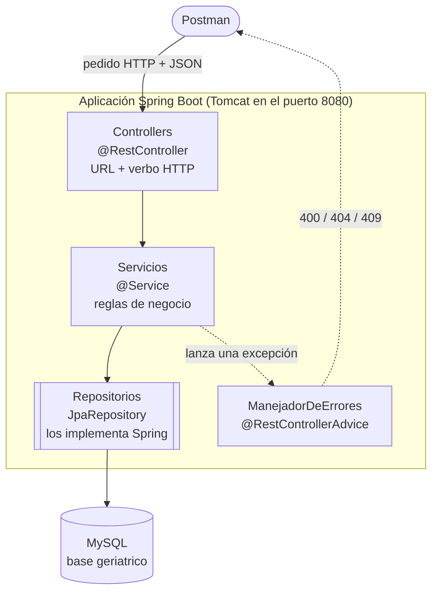
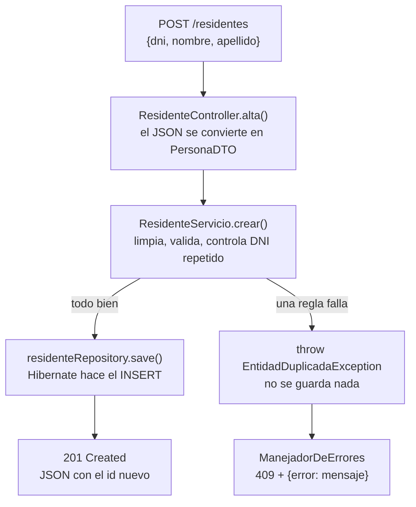
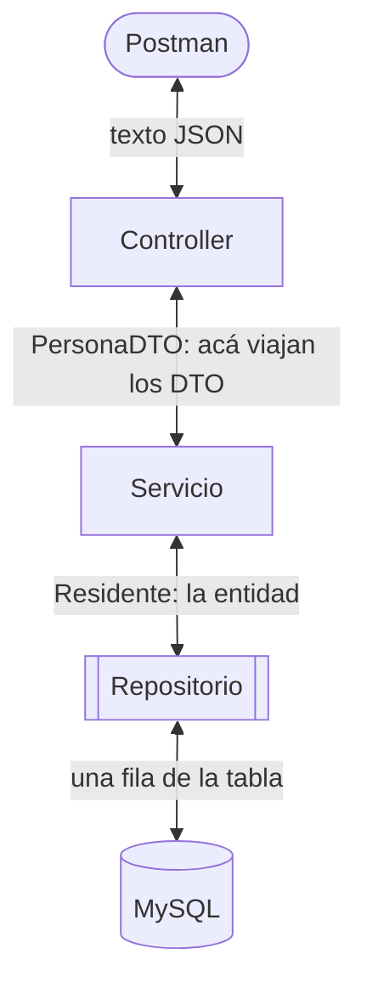

# Arquitectura de la API

[← Volver al README](../README.md)

Explicación de cómo está armado el proyecto, para estudiarlo y para defenderlo.

---

## 1. ¿Qué es este proyecto? Una API REST

**Sí: es una API REST.**

- **API** (interfaz de programación de aplicaciones): un programa que no le habla a una persona con menús, sino a **otros programas**. Recibe pedidos y devuelve datos. Funciona como un mozo: toma el pedido, lo lleva a la cocina y trae la respuesta.
- **REST** es una forma de diseñar esa API sobre HTTP, con estas reglas:
  - Cada cosa del sistema es un **recurso** con su URL: `/residentes`, `/habitaciones`, `/reservas`.
  - Lo que se hace con el recurso lo dice el **verbo HTTP**: `GET` lee, `POST` crea, `PUT` modifica, `DELETE` borra.
  - Los datos viajan en **JSON**.
  - El resultado se informa con un **código de estado**: 200 OK, 201 creado, 204 sin contenido, 400 dato mal, 404 no existe, 409 conflicto.
  - **Sin estado**: cada pedido trae todo lo que necesita; el servidor no "recuerda" en qué pantalla estabas.

Por eso no hay menú: el "menú" ahora son las URLs. En vez de elegir "1. Alta" en la consola, se manda `POST /residentes` desde Postman.

| Consola | API REST |
|---|---|
| Menú "Residentes → 1. Alta" | `POST /residentes` con un JSON |
| Menú "Residentes → 2. Listar" | `GET /residentes` |
| Mensaje "Registrado." | Código **201** y el residente creado en JSON |
| Mensaje "No se pudo completar: ..." | Código **400 / 404 / 409** con `{"error": "..."}` |

---

## 2. Las capas



**Regla:** cada capa solo conoce a la de abajo. Se puede comprobar en el código: **ningún controller importa una clase de `modelos` ni de `repositorios`**; solo usan servicios y DTO.

---

## 3. Qué pasa en un pedido: `POST /residentes`



El servicio **no sabe que existe HTTP**: tira la misma excepción que en la consola. En la consola la atrapaba la vista e imprimía el mensaje; acá la atrapa `ManejadorDeErrores` y la traduce a un código HTTP.

---

## 4. ¿Quién crea los objetos? Inversión de control e inyección de dependencias

En la consola, el `Main` hacía todo a mano:

```java
GenericDAO<Residente, Integer> residenteDAO = new ResidenteDAOArchivo(...);
ResidenteServicio residenteServicio = new ResidenteServicio(residenteDAO, ...);
menu.registrar(new VistaPersonas("Residentes", new ResidenteController(residenteServicio), consola));
```

En Spring **no hay ni un `new` de esos**. Al arrancar, Spring:

1. Recorre los paquetes y encuentra las clases marcadas con `@RestController`, `@Service` y `@Repository`.
2. Crea **un objeto de cada una**.
3. Mira el constructor de cada clase y **le pasa lo que pide**. Por ejemplo, `ResidenteServicio` pide un `ResidenteRepository`, y Spring se lo da.

- **Inversión de control (IoC):** el framework maneja el armado y el flujo; nuestro código solo se ejecuta cuando llega un pedido.
- **Inyección de dependencias (DI):** cada clase recibe por constructor lo que necesita, en vez de crearlo ella. Es lo mismo que hacía el `Main` de la consola, pero automático.

---

## 5. Qué es cada paquete

| Paquete | Qué hace | En la consola era |
|---|---|---|
| `modelos` | Las tablas. `@Entity` = "esta clase es una tabla", `@Id` = clave primaria | Los mismos modelos, sin anotaciones |
| `repositorios` | Leer y guardar en MySQL. Son interfaces casi vacías: Spring escribe el código | `GenericDAO` + `ArchivoDAO` + un DAO por entidad |
| `servicios` | **Las reglas de negocio.** Es lo más importante y casi no cambió | Igual |
| `dto` | Lo que entra y sale como JSON | Igual (antes viajaba entre la vista y el servicio) |
| `controllers` | Qué URL y qué verbo atiende cada método, y el manejo de errores | Controllers + vistas + menús |
| `excepciones` | Qué salió mal, con nombre propio | Igual (sin `PersistenciaException`) |

**La idea de fondo:** como la consola ya estaba bien separada en capas, pasar a Spring fue cambiar solo las puntas. Arriba, las vistas pasaron a ser controllers REST. Abajo, los archivos pasaron a ser MySQL. **El medio (los servicios con las reglas) quedó igual.** Eso es la D de SOLID: los servicios dependen de una abstracción (el repositorio), no de cómo se guarda.

---

## 6. Las anotaciones, en una línea

| Anotación | Significa |
|---|---|
| `@Entity` / `@Table(name = "...")` | Esta clase es una tabla y se llama así |
| `@Id` | Este campo es la clave primaria |
| `@GeneratedValue(strategy = IDENTITY)` | El valor lo genera MySQL (`AUTO_INCREMENT`) |
| `@MappedSuperclass` | `Persona` no es tabla: sus campos se copian a las tablas de las hijas |
| `@NoRepositoryBean` | `PersonaRepository` es solo un molde; Spring no crea un repositorio para ella |
| `@Repository` / `@Service` / `@RestController` | "Spring, creá un objeto de esta clase y manejalo vos" |
| `@RequestMapping("/residentes")` | URL base de todo el controller |
| `@GetMapping`, `@PostMapping`, `@PutMapping`, `@DeleteMapping` | Este método atiende ese verbo HTTP |
| `@PathVariable` | El dato viene en la URL: `/residentes/1` |
| `@RequestParam` | El dato viene después del `?`: `/reservas?idResidente=1&codigo=HAB-101` |
| `@RequestBody` | El dato viene en el JSON del cuerpo del pedido |
| `@ResponseStatus(CREATED)` | Responder 201 en vez de 200 |
| `@RestControllerAdvice` + `@ExceptionHandler` | Atrapar las excepciones de todos los controllers en un solo lugar |

---

## 7. Los DTO

### ¿No son lo mismo que los controllers?

No. **Un DTO no es una capa: es lo que viaja entre capas.** El controller es *la puerta*; el DTO es *el paquete que pasa por la puerta*.



El **servicio es la frontera**:
- **Entra** un `PersonaDTO` → el servicio lo valida y lo convierte en entidad con `crearPersona(...)` → `new Residente(...)`.
- **Sale** una entidad de la base → el servicio la convierte en DTO con `PersonaDTO.desde(...)` → el controller la devuelve y Spring la convierte en JSON.

### ¿Para qué sirven? Tres razones

1. **Protegen lo que entra.** Si el controller recibiera un `Residente` directo, alguien podría mandar `{"id": 3, ...}` en un alta y pisar al residente 3. Con el DTO, el servicio decide qué datos usa: en el alta ignora el id y lo genera MySQL.
2. **Permiten mostrar cosas que no son tablas.** Ninguno de estos existe en la base:
   - `HabitacionDTO` tiene `ocupada`, que **se calcula** a partir de las reservas.
   - `HabitacionDetalleDTO` junta habitación + residente + enfermero en una sola respuesta.
   - `PersonaHabitacionDTO` junta una persona con el código de su habitación.
3. **Separan la base de lo que ve el usuario.** Si cambia una columna de la tabla, el JSON de la API puede seguir igual: solo cambia cómo se arma el DTO.

---

## 8. Dónde se usa `PersonaDTO`

| Dónde | Qué hace ahí |
|---|---|
| `PersonaController.alta()` y `modificar()` | **Entra**: `@RequestBody PersonaDTO datos` (Spring convierte el JSON en este objeto) |
| `PersonaController.listar()`, `buscar()`, `alta()`, `modificar()` | **Sale**: devuelven `PersonaDTO` o `List<PersonaDTO>` (Spring lo convierte en JSON) |
| `PersonaServicio.crear()` y `modificar()` | Lo recibe, lo limpia (`limpiar`), lo valida (`validar`) y con sus datos crea la entidad (`crearPersona`). Devuelve un `PersonaDTO` armado con `PersonaDTO.desde(guardada)`, que ya trae el id que puso MySQL |
| `PersonaServicio.listar()` y `obtener()` | Convierte cada entidad en DTO con `PersonaDTO.desde(...)` |
| `PersonaServicio.validar()` | Usa sus constantes `PATRON_DNI` y `PATRON_NOMBRE` |
| `ReservaServicio.residentesSinHabitacion()` | Devuelve `List<PersonaDTO>` (lo usa `ReservaController`) |
| `ReporteServicio`: las 3 consultas | `residentesDeEnfermero` devuelve `List<PersonaDTO>`, `enfermeroDeResidente` devuelve `Optional<PersonaDTO>` y `habitacionDeResidente` lo mete adentro de un `PersonaHabitacionDTO` |
| `HabitacionServicio.obtener()` | Arma el residente y el enfermero de la habitación como `PersonaDTO` |
| Adentro de otros DTO | `PersonaHabitacionDTO.persona` y `HabitacionDetalleDTO.residente` / `.enfermero` son `PersonaDTO` |

`PersonaDTO.desde(Persona p)` es el **único lugar** donde se convierte una entidad en DTO. Antes, cada servicio tenía su propio método `aDTO()` igual, y eso era código duplicado.

---

## 9. ¿Por qué la entidad `Residente` no sale del servicio?

Porque **la entidad es de la base de datos y el DTO es de la API**. Si el controller devolviera o recibiera `Residente`:

- **Seguridad**: el usuario podría mandar campos que no debería tocar (como el `id`).
- **Acoplamiento**: el JSON de la API quedaría atado a cómo es la tabla; cualquier cambio en la base rompería a quien usa la API.
- **Capas**: el controller tendría que conocer `modelos`, y saltearía la capa de servicio, que es donde están las reglas.
- **JPA**: una entidad está "conectada" a Hibernate; mandarla afuera, o recibirla tal cual desde afuera, puede guardar o mostrar cosas que no queríamos.

Por eso la regla es: **las entidades viven del servicio para abajo; los DTO, del servicio para arriba**. En el código se cumple: ningún controller importa nada del paquete `modelos`.

---

## 10. Preguntas para la defensa oral

- **¿Qué es una API REST?** Un programa que expone recursos con URLs; se opera con verbos HTTP, intercambia JSON y responde con códigos de estado.
- **¿Qué hace Spring por vos?** Crea los objetos y los conecta (IoC/DI), levanta el servidor Tomcat, convierte JSON ↔ objetos e implementa los repositorios.
- **¿Qué es JPA y qué es Hibernate?** JPA es la especificación (las anotaciones `@Entity`, `@Id`...). Hibernate es la implementación que traduce los objetos a SQL. Spring Data JPA da los repositorios listos.
- **¿Por qué `Persona` es `@MappedSuperclass` y no `@Entity`?** Porque no hay "personas sueltas": solo residentes y enfermeros. Cada uno tiene su tabla con los campos heredados.
- **¿Por qué el `@Id` de `Reserva` es el código de habitación?** Porque una clave primaria no se repite: la base misma impide que una habitación tenga dos reservas.
- **¿Qué cambió de la consola?** Las puntas: vistas → controllers REST, archivos → MySQL. Las reglas (servicios) quedaron iguales.
- **¿Para qué sirve el DTO?** Ver la sección 7.
